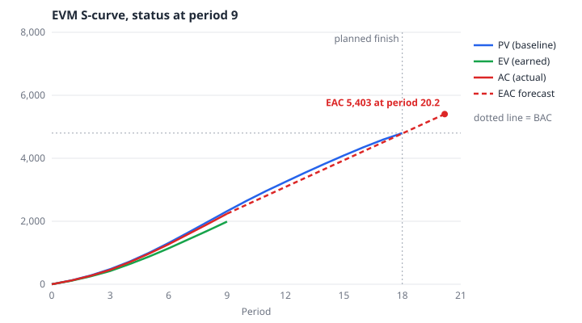

# AI-Native Program Management

**Ademola (Ade) Apata, P.Eng, PMP** | Defense NPI, program controls and EVM | Niagara Region, Ontario | [LinkedIn](https://www.linkedin.com/in/ademola-apata)

Most program reviews spend twenty minutes on numbers and two minutes on what to do about them. I build small tools that flip that ratio. They take the raw data a program already has and turn it into a forecast and a decision a leader can act on.

Everything here is something I have needed on real defense programs, rebuilt from scratch on public methods and made-up data.

## The toolkit

| Tool | The question it answers | Status |
|---|---|---|
| [EVM Forecaster](evm-forecaster/) | Where will this program actually land on cost and finish date, and is the recovery plan believable? | Done |
| Schedule Health Check | Is this schedule good enough to trust? (DCMA 14-point assessment) | Next |
| AI Status Brief | Can the monthly program update write itself, with the answer first? | Planned |

## How I think about program health

- **A forecast nobody can act on is just a report.** Every tool ends with a bottom line and an ask, not a table.
- **Cumulative CPI rarely recovers once a program is past about 20% complete.** I would rather tell leadership early than defend a hopeful EAC for six months.
- **Classic SPI quietly drifts back to 1.00 as a program nears the end, even when it is late.** Earned Schedule fixes that, so the finish date forecast stays honest.
- **The schedule is a model of the work, not a picture of it.** If the logic is broken, every date it produces is fiction.

## Background

Most of my career has been in the messy middle of NPI, where engineering, supply chain and the shop floor all have to land on the same date. Most recently I spent close to four years as Senior Program Scheduler and Project Manager at Curtiss-Wright Defense Solutions, running a naval defense program from contract award through production, FAT and delivery. Before that came manufacturing engineering and project delivery in metal fabrication, supply chain planning, and plant operations.

A few outcomes behind these tools:

- Cut FAT duration by 18% with readiness checklists built around design-for-test thinking
- Reduced lead time 15% using historical schedule data, with zero missed critical milestones
- 100% on-time delivery across concurrent programs, while unplanned NPI costs came down 10%
- Earlier in my career, took plant uptime from 81% to 93% using real-time SAP data

Day to day that means building and running integrated master schedules, EVM, Oracle and SAP ERP, MS Project and Power BI, and making sure the numbers turn into decisions at the program review.

**Credentials:** P.Eng (Professional Engineers Ontario). PMP. Lean Six Sigma Green Belt. Controlled Goods Program security clearance (PSPC). Data and Predictive Analytics certificate (Toronto Metropolitan University). M.Eng Industrial Engineering (Concordia). B.A.Sc Chemical Engineering and Finance (University of Ottawa).

## About the data

**All data in this repository is synthetic.** No employer, customer or program information is used anywhere, and none of these tools were built with or on company systems. The methods come from public standards (PMI, DCMA, the Earned Schedule literature). In defense work, keeping that line clean matters as much as the analysis.

## Built with AI, owned by me

I build these with Claude as a pair programmer. I define the problem, the method and the rules for what good looks like. AI speeds up the code. Every number in every output is something I can explain and defend in a program review.
